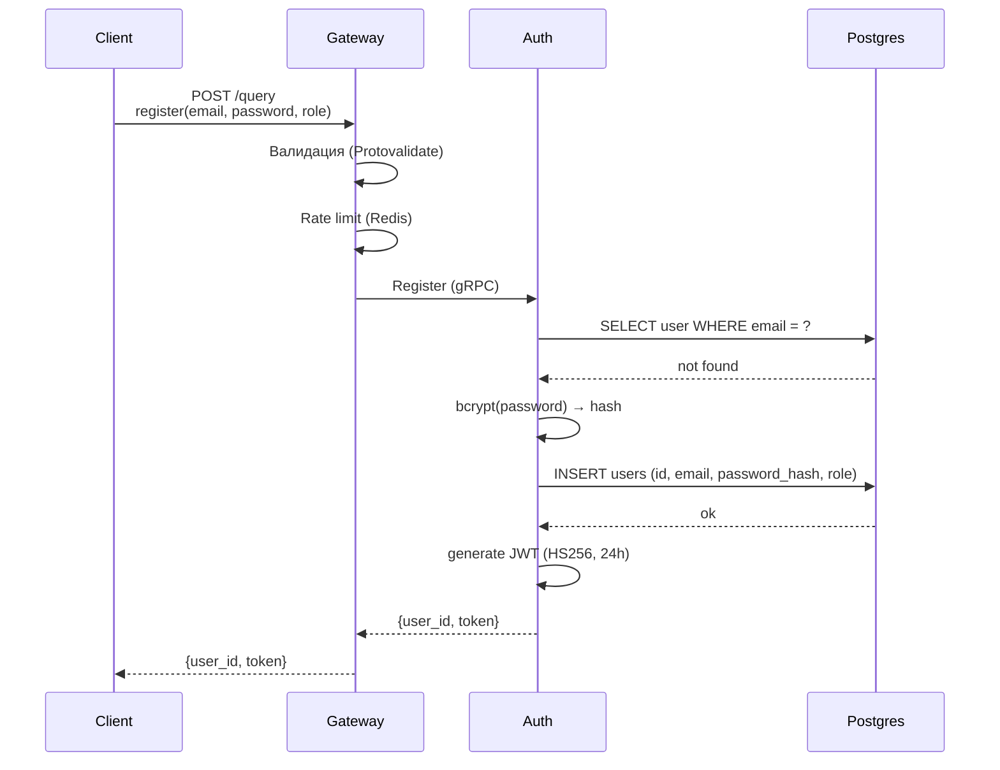
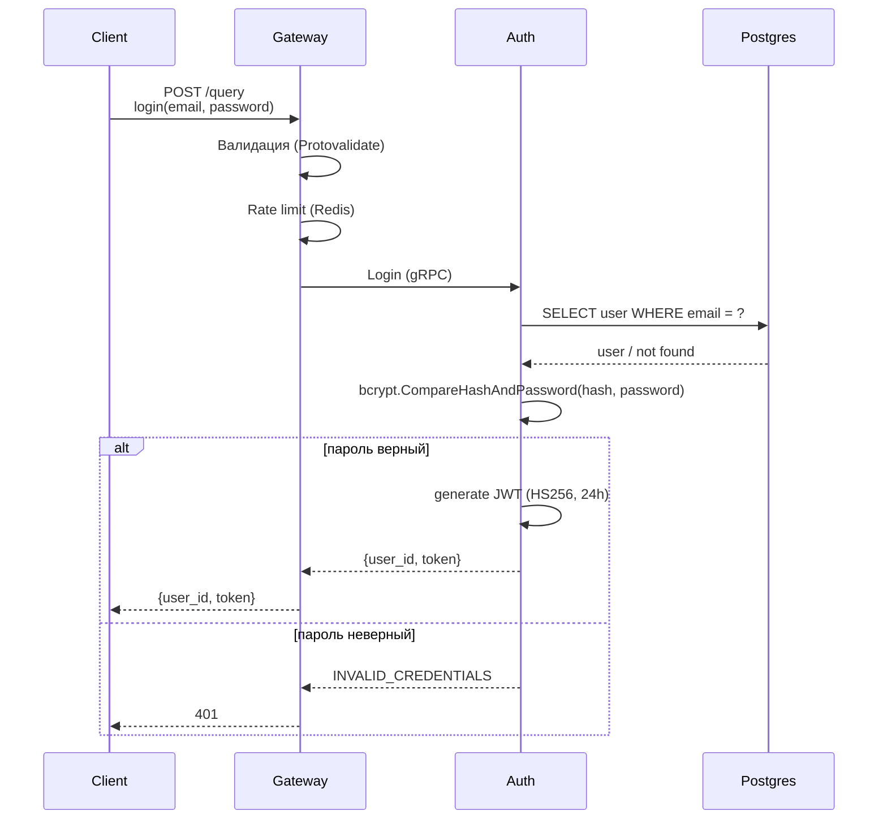
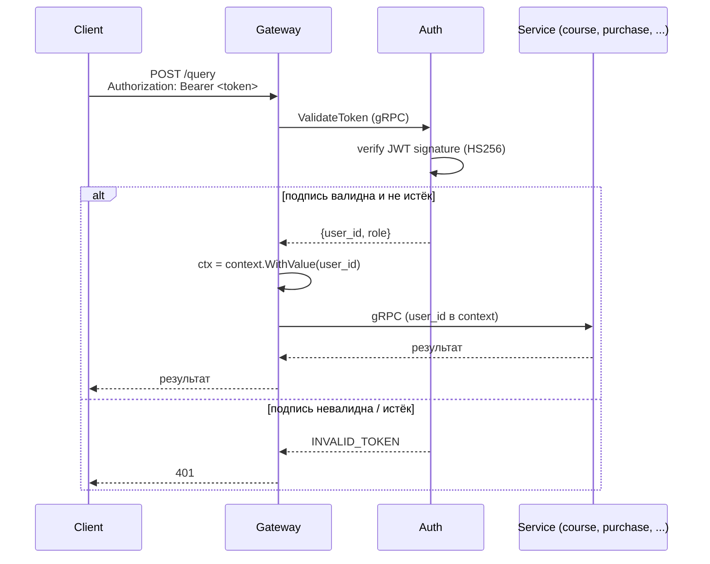
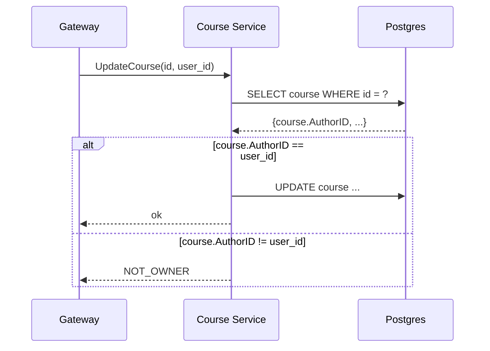

# Схема идентификации и аутентификации

## 1. Введение

Платформа курсов использует **JWT-аутентификацию** для идентификации пользователей и передачи подтверждённой идентичности между сервисами. Клиент проходит регистрацию и логин через **gateway**, получает **JWT-токен**, и передаёт его в заголовке `Authorization: Bearer <token>` при каждом запросе.

Внутри системы **каждый сервис** (auth, course, purchase, payment, media, activity) **не хранит сессий**. Вместо этого gateway **валидирует JWT** через auth-сервис и **кладёт `user_id` в контекст запроса**. Дальше сервисы **читают `user_id` из контекста** - это **доверенная идентичность**.

Архитектура разделена на **два контура**: **внешний** (gateway, доступен из интернета) и **внутренний** (сервисы, БД, Kafka, Redis, MinIO - доступны только изнутри). **Секреты** (JWT-ключ, пароли БД) хранятся в **Vault** и **не попадают** в код или env-файлы в проде.

## 2. Идентификация пользователя

Система использует **два идентификатора**:

| Идентификатор | Тип | Где используется | Можно ли изменить |
|---|---|---|---|
| **`user_id`** | UUID | Внутри системы: БД, JWT, между сервисами | **Никогда** |
| **`email`** | String | Только при регистрации и логине | **Можно** (смена почты) |

**`user_id`** - **внутренний** идентификатор. Генерируется один раз при регистрации (UUID v4) и **никогда не меняется**. Все связи в БД - по `user_id`. JWT содержит `user_id`. Gateway передаёт `user_id` в контексте запроса.

**`email`** - **внешний** идентификатор. Используется **только** для входа (логин) и регистрации. Пользователь может **сменить email** (например, при смене работы). Если бы все связи были по email - пришлось бы обновлять всё. С `user_id` - email меняется, остальное не трогается.

**Почему два идентификатора:** `email` можно сменить - если бы связи были по email, пришлось бы обновлять всё. `user_id` - неизменный, все связи по нему.

## 3. Хранение пароля

Пароль **никогда не хранится в открытом виде**. В БД - **bcrypt-хеш**.

**Параметры:**
- **Алгоритм:** bcrypt
- **Cost:** 10 (в проде - 12-14)
- **Хранение:** только в БД (`users.password_hash`, 60 символов)

**При регистрации:** `bcrypt.GenerateFromPassword(password, cost=10)` → `INSERT users (password_hash)`.

**При логине:** `SELECT password_hash FROM users` → `bcrypt.CompareHashAndPassword(hash, password)`.

**Что не попадает:**
- **В JWT** - никогда
- **В логи** - никогда
- **В env** - не нужно (хеш, не секрет)

**В проде:**
- Cost выше (12-14)
- **Pepper** - дополнительный секрет из Vault, применяется к паролю **перед** хешированием
- **Argon2id** вместо bcrypt - современнее

## 4. Фаза 1: Регистрация



**Ошибки:** `INVALID_INPUT` (валидация), `EMAIL_TAKEN` (email занят), `429` (rate limit).

**Что важно:**
- **Пароль** передаётся по **TLS** (в проде) и **никогда не логируется**.
- **Хеш** - только в БД. В JWT **не попадает**.
- **JWT** содержит `user_id` и `role` - этого достаточно для авторизации в других сервисах.


## 5. Фаза 2: Логин



**Ошибки:** `INVALID_INPUT` (валидация), `INVALID_CREDENTIALS` (неверный email или пароль), `429` (rate limit).

**Что важно:**
- **`INVALID_CREDENTIALS`** - **одна ошибка** на оба случая (email не найден / пароль неверный).
- **Пароль** передаётся по **TLS** (в проде) и **никогда не логируется**.
- **JWT** - тот же формат, что при регистрации (`user_id`, `role`, 24h).
- **Rate limit** на логин **строже**, чем на регистрацию.

## 6. Фаза 3: Проверка токена при запросе



**Ошибки:** `UNAUTHENTICATED` (нет токена), `INVALID_TOKEN` (невалидный или истёк).

**Что важно:**
- **Проверка на каждом запросе.** JWT **не хранится** в Redis или сессии - auth проверяет **подпись** и **exp**.
- **`user_id` и `role`** - из JWT, **не из тела запроса**. Клиент **не может** подделать.
- **Сервисы не валидируют JWT** - они **доверяют gateway**. В проде - gateway + сервисы за mTLS, gateway **подписывает** внутренние вызовы.

## 7. Временная схема: жизненный цикл токена

```mermaid
gantt
    title Жизненный цикл JWT (TTL 24h)
    dateFormat HH:mm
    axisFormat %H:%M

    section Токен
    Активен (доступ разрешён)   :active, t1, 00:00, 24h
    Требуется повторный логин    :crit, t2, after t1, 2h
```



**Как читать:**
- **`t=0`** - логин, выдан JWT с `exp = now + 24h`.
- **`0 < t < 24h`** - токен валиден, запросы проходят.
- **`t ≥ 24h`** - токен истёк, `INVALID_TOKEN`, клиент **логинится заново**.

**Что важно:**
- **Клиент не обновляет токен автоматически** - после истечения нужен **повторный логин**.
- **В проде:** access 15min + refresh 7d - access живёт **коротко**, refresh - **долго**, клиент **обновляет** access без логина.

## 8. JWT: выпуск, проверка, секрет

**Claims в токене:** `user_id`, `role`, `exp` (24h), `iat`.

**Чего нет в payload:** email, пароль, секреты. `user_id` и `role` достаточно для авторизации.

**Алгоритм:**
- **Сейчас:** HS256 - симметричный, один секрет.
- **В проде:** RS256 - асимметричный, приватный ключ (подпись) + публичный (проверка).

**Где хранится секрет:**
- **Сейчас:** env-переменная `JWT_SECRET` в `docker-compose.yml`
- **В проде:** Vault - auth получает секрет по запросу, автоматическая ротация

**Кто имеет секрет:** только auth-сервис (подписывает токены). Остальные сервисы **не имеют** - проверяют через auth (`ValidateToken` по gRPC).

## 9. Защита связи (TLS / mTLS)

**Три уровня связи:**

| Связь | Сейчас (прототип) | В проде |
|---|---|---|
| **Клиент → Gateway** | HTTP | HTTPS (TLS) |
| **Gateway → Сервисы** | gRPC insecure | gRPC + TLS |
| **Сервис → Сервис** | gRPC insecure | gRPC + mTLS |

**Сейчас:** всё внутри Docker-сети, `insecure.NewCredentials()` - без TLS.

**В проде:**
- **Клиент → Gateway:** HTTPS, сертификат от Let's Encrypt / Cloudflare. Gateway в **DMZ** (внешний контур).
- **Gateway → Сервисы:** gRPC + TLS. Gateway в DMZ, сервисы - во **внутреннем контуре**. Файрвол: DMZ → внутренний - разрешено, обратно - нет.
- **Сервис → Сервис:** **mTLS** - обе стороны предъявляют сертификаты.

**Как выпускаются сертификаты (PKI):**
- Свой приватный CA - выдаёт сертификаты сервисам
- Или **Vault PKI** - короткий TTL (24h), автоматическая ротация
- Или **service mesh** (Istio, Linkerd) - mTLS автоматически, без кода

## 10. Права доступа

**Два уровня проверки:**

### 1. Роль (в gateway)

Gateway проверяет **роль из JWT** через директиву `@auth(roles: [...])`:

```graphql
createCourse(...): Course! @auth(roles: [TEACHER])
purchaseCourse(...): Purchase! @auth(roles: [STUDENT])
```

Если роль **не совпадает** - `FORBIDDEN`, запрос **не доходит** до сервиса.

### 2. Владение ресурсом (в сервисе)

Сервис проверяет, что **пользователь - владелец** ресурса. Пример: редактирование курса.



**Что проверяется где:**

| Проверка | Где | Пример |
|---|---|---|
| Аутентификация (есть токен?) | Gateway | `@auth` |
| Роль | Gateway | `@auth(roles: [TEACHER])` |
| Владение | Сервис | `course.AuthorID == user_id` |
| Бизнес-правила (курс опубликован?) | Сервис | `course.Status == PUBLISHED` |

**Важно:** `user_id` для проверки владения - **из JWT** (через `context`), **не из тела запроса**. Клиент **не может** подделать.

## 11. Rate limiting и защита от перебора

### Rate limiting (gateway)

**Redis** хранит счётчики запросов по ключу `rate:{user_id}` или `rate:{ip}`.

**Лимиты:**
- **Общий API:** 100 req/min на пользователя
- **Login:** 5 req/min на email (строже - защита от brute force)
- **Register:** 3 req/min на IP

**Алгоритм:** sliding window. Redis `INCR` + `EXPIRE 60s` - счётчик живёт 60 секунд от первого запроса, потом сбрасывается. При превышении - `429 Too Many Requests`.

### Защита от перебора паролей

**Многоуровневая:**

1. **Rate limit на login** - 5 попыток в минуту на email. После - `429`.
2. **Lockout** - после 10 неудач за 15 минут - блокировка email на 15 минут. Счётчик в Redis: `lockout:{email}`.
3. **`INVALID_CREDENTIALS`** - одна ошибка на «email не найден» и «пароль неверный». Не раскрываем, что именно.
4. **Логирование** - все неудачные попытки в логи (для аудита, алертов).

**В проде:** добавить CAPTCHA после 3 неудач (Cloudflare Turnstile, reCAPTCHA v3).

## 12. Контекст: где физически живут компоненты

**Сейчас (прототип):** всё в одной Docker-сети (`backend_default`). Gateway, сервисы, Postgres, Kafka, Redis, MinIO - 12 контейнеров на одной машине. TLS нет.

**В проде (облако AWS/GCP):**

**Сеть (VPC):** все компоненты в **одной VPC**, но в **разных подсетях**:

| Контур | Компоненты | Доступ из интернета |
|---|---|---|
| **DMZ** (публичная подсеть) | Gateway, балансировщик, CDN | Да |
| **Внутренний** (приватная подсеть) | Auth, Course, Purchase, Payment, Media, Activity, Postgres, Kafka, Redis, MinIO | Нет |

**Файрвол:** DMZ → внутренний - разрешено. Обратно - нет.

**Секреты (Vault):** `JWT_SECRET`, пароли БД - в **Vault**, не в env. Auth получает секрет по запросу, автоматическая ротация. В прототипе - env-переменные.

**Сертификаты (PKI):** в проде - свой приватный CA или Vault PKI. Сертификаты для TLS/mTLS, TTL 24h, автоматическая ротация.

**VM / контейнеры:** каждый сервис - отдельный контейнер (в K8s - pod). Масштабируется горизонтально: 3 реплики gateway, 2 реплики auth и т.д.

**Metadata (защита от SSRF):** сервисы **не должны** запрашивать `169.254.169.254` по пользовательским URL. Если есть upload по URL - валидировать домен, блокировать link-local.