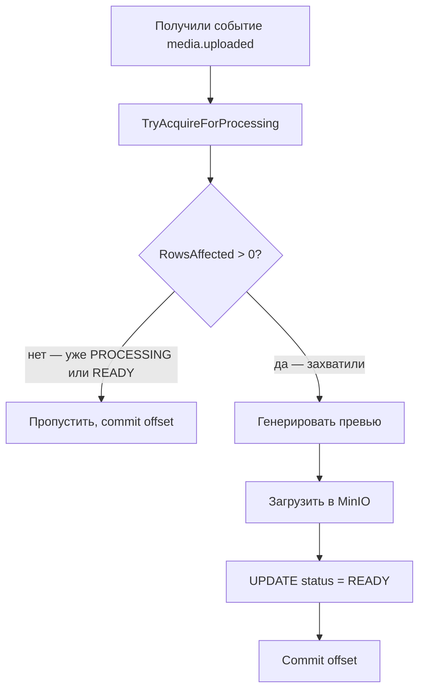

# Обработка медиа через Kafka

## 1. Введение

Сервис `media` публикует событие `media.uploaded` в Kafka после загрузки файла в MinIO. Сервис `media-worker` читает событие, генерирует превью (ресайз картинки), загружает его в MinIO и обновляет статус в БД (`PROCESSING → READY`).

**Требования к обработке:**
- **Graceful shutdown** — при остановке worker **завершает** текущую задачу, **не берёт** новые.
- **At-least-once** — offset коммитится **после** успешной обработки.
- **Идемпотентность** — повторная доставка **не создаёт** дубликат результата.
- **Безопасность** — ограничение размера файла, безопасные временные файлы.

## 2. Graceful shutdown

При остановке worker (SIGTERM, `docker compose stop`) происходит следующее:

1. **`signal.NotifyContext`** ловит SIGTERM → отменяет `ctx`.
2. **Consumer получает `ctx.Done()`** — перестаёт вызывать `ReadMessage`.
3. **Текущая обработка завершается** — `processMessage` **не прерывается** на середине. Проверка `ctx.Err()` — только **перед** критическими шагами (загрузка в MinIO, обновление статуса), **не** внутри них.
4. **Offset коммитится** после завершения (если обработка успешна).
5. **`defer` в main** — закрывает соединения (MinIO, Postgres, Kafka).

**Что важно:**
- **Новые задачи не берутся** — `ReadMessage` не вызывается после `ctx.Done()`.
- **Текущая задача завершается** — не обрывается на полпути.
- **Offset не коммитится**, если задача **не завершена** — Kafka отдаст её **снова** после рестарта.
- **Таймаут на shutdown** — `main` ждёт завершения, но **не дольше** `SHUTDOWN_TIMEOUT` (например, 30s). Если не успело — force kill.

## 3. Идемпотентность

**Проблема:** Kafka гарантирует at-least-once — сообщение может прийти дважды (сбой worker'а, rebalance). Без защиты превью генерируется дважды. Плюс: два worker'а могут одновременно взять одно сообщение — race condition.

**Решение:** атомарный захват задачи через `UPDATE ... WHERE status NOT IN (PROCESSING, READY)`.



**Что защищает:**
- **Повторная доставка** — статус `READY` → пропуск.
- **Race condition** — `UPDATE` атомарный в Postgres. Первый worker захватывает (`RowsAffected = 1`), второй — нет (`RowsAffected = 0`).
- **Сбой до `UPDATE`** — превью в MinIO уже есть, но статус `PROCESSING`. При повторе — генерация заново, перезапись того же ключа. Результат тот же.
- **Ключ в MinIO детерминированный** (`media/{id}/preview/{filename}.jpg`) — повтор не создаёт дубликат.

## 4. Ограничение размера и безопасные временные файлы

**Проблема:** файл может быть огромным — `Download` в память → OOM. Временные файлы на диске — если не удалить, копятся. Права доступа — если `0644`, другие процессы могут читать.

**Решение:**

**Ограничение размера:**
- **`MaxFileSize = 50 MB`** — константа в `worker.go`
- **Проверка** `event.Size > MaxFileSize` — перед `Download`
- Если превышено — `status = FAILED`, **пропускаем** (не ошибка, offset коммитится)
- **`Size`** передаётся в `MediaUploadedEvent` (публикуется `media` при upload)

**Безопасные временные файлы:**
- **`os.CreateTemp`** — уникальное имя, **атомарно**, права **`0600`** (только владелец)
- **`defer os.Remove`** — гарантированное удаление
- **`defer tmpFile.Close`** — гарантированное закрытие
- **Потоковая обработка** — скачать в файл, обработать, загрузить, удалить. **Вместо** `[]byte` в памяти

**Что важно:**
- **`MaxFileSize`** — защита от OOM. **В проде** — на уровне MinIO (bucket policy) + приложения.
- **`0600`** — только владелец. **`os.Remove`** — даже при панике (через `defer`).
- **В прототипе** — `Download` в памяти, но **с проверкой размера**. **Временные файлы** — в проде.

## 5. Тестирование остановки сервиса

**Цель:** убедиться, что при `SIGTERM` worker **завершает** текущую задачу и **не берёт** новые.

### Локально (без Docker)

**1. Запустить worker** в терминале:
```bash
go run ./cmd/media-worker
```

**2. Загрузить файл** через gateway (Playground):
```graphql
mutation {
  uploadMedia(input: {fileName: "test.png", contentType: "image/png", contentBase64: "..."}) {
    id
  }
}
```

**3. Сразу нажать `Ctrl+C`** в терминале worker'а (отправляет `SIGINT` — аналог `SIGTERM`).

**4. Смотреть логи:**
- `processing media` — задача **началась**
- `preview generated` — задача **завершилась** (worker **дождался**)
- `media-worker stopped` — worker **остановился**

**5. Проверить БД:** `status = READY` (задача **завершена**).

**Если статус `PROCESSING`** — worker **прервал** задачу. **Баг в graceful shutdown.**

### Через Docker Compose

**1. Запустить сервисы:**
```bash
docker compose up -d
```

**2. Загрузить файл** через Playground.

**3. Сразу остановить worker:**
```bash
docker compose stop media-worker
```
(`docker compose stop` отправляет `SIGTERM`.)

**4. Смотреть логи worker'а:**
```bash
docker compose logs media-worker --tail 20
```

**5. Проверить БД:**
```bash
docker exec artplatform-postgres psql -U artplatform -d artplatform -c "SELECT id, status FROM media_files ORDER BY created_at DESC LIMIT 1;"
```

**Что искать:**
- `processing media` → `preview generated` → `media-worker stopped`
- `status = READY` — задача **завершена**

**Если `status = PROCESSING`** — worker **не дождался** завершения.

### Проверка offset (at-least-once)

**1. Остановить worker** во время обработки (как выше).

**2. Проверить consumer group:**
```bash
docker exec artplatform-kafka /opt/kafka/bin/kafka-consumer-groups.sh --bootstrap-server localhost:9092 --describe --group media-worker
```

**Смотреть `LAG`:**
- **`LAG > 0`** — offset **не закоммичен** (задача не завершена) → Kafka **отдаст** сообщение **снова** после рестарта
- **`LAG = 0`** — offset закоммичен (задача завершена)

**3. Запустить worker снова:**
```bash
docker compose start media-worker
```

**4. Смотреть логи:** worker **прочитает** сообщение снова → `processing media` → `preview generated`.

**Что это доказывает:**
- **При сбое** offset **не коммитится** → сообщение **не теряется**
- **После рестарта** worker **обработает** снова
- **Идемпотентность** — если превью **уже было**, `TryAcquireForProcessing` **пропустит** (или перезапишет тот же ключ)

### Что тестировать (чек-лист)

| # | Сценарий | Ожидаемо |
|---|---|---|
| 1 | `Ctrl+C` во время обработки | Задача завершается, `status = READY` |
| 2 | `docker compose stop media-worker` во время обработки | Задача завершается, `status = READY` |
| 3 | Остановка **до** обработки | Задача **не начата**, `status = PROCESSING` |
| 4 | После сбоя `LAG > 0` | Kafka **отдаст** снова |
| 5 | После рестарта | Задача **обработана** повторно (или пропущена) |